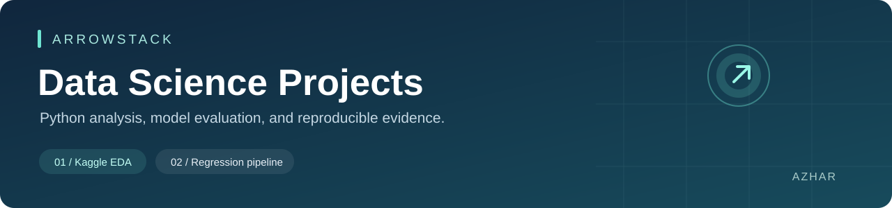

# Arrowstack · Data Science

Two reproducible Python projects: **Kaggle exploratory data analysis** and an
**end-to-end predictive regression pipeline**. Prepared for **Azhar** with source
data, executed notebooks, measured results, figures, documentation, and tests.

[Quick start](#quick-start) · [Task 1](task1_eda/README.md) · [Task 2](task2_regression/README.md)
· [Roman Urdu beginner guide](docs/BEGINNER_GUIDE.md) · [Demo guide](docs/DEMO_GUIDE.md)

## Projects

| Project | Dataset | What it demonstrates | Open the work |
| --- | --- | --- | --- |
| 01 · Comprehensive EDA | Kaggle Palmer Penguins, 344 observations | Quality checks, missingness, group statistics, correlations, outlier review, bootstrap intervals, responsible conclusions | [Notebook](task1_eda/notebooks/penguins_eda.ipynb) · [Report](task1_eda/reports/final_report.md) |
| 02 · Predictive regression | UCI Auto MPG, 398 records | Group-aware splitting, preprocessing pipelines, five-fold CV, model comparison, holdout metrics, serialization, prediction CLI | [Notebook](task2_regression/notebooks/auto_mpg_regression.ipynb) · [Report](task2_regression/reports/final_report.md) |

**Scope note:** these projects implement the first two titles in the supplied
**Data Science dashboard screenshot**. The separate Churn/Retail handbook discussed
earlier is a different specification. Full official PDF/rubric compliance is not
claimed. See [requirements and decisions](docs/REQUIREMENTS.md).

## Results at a glance

### Task 1: understand the data before interpreting it

- All **344 records** are retained; **333** are complete cases.
- One nonstandard sex marker is corrected to missing. No measurements are imputed.
- Mean mass is approximately **5,076 g for Gentoo**, **3,733 g for Chinstrap**,
  and **3,701 g for Adelie** in this sample.
- Flipper length and body mass have pooled Pearson **r = 0.871**, but their
  within-species relationships differ. Species and island are confounded.


### Task 2: select on training folds, evaluate on held-out names

Five candidate configurations are compared, including a mean-prediction baseline.
**Gradient Boosting** has the lowest mean training-fold RMSE. The final test set
contains **77 records from 61 names**, with no exact normalized car-name overlap
with the **321 training records**.

| Holdout metric | Gradient Boosting | Training-mean baseline |
| --- | ---: | ---: |
| MAE (mpg) | 1.940 | 6.473 |
| MSE (mpg²) | 7.233 | 63.288 |
| RMSE (mpg) | 2.689 | 7.955 |
| R² | 0.885 | −0.007 |

These are actual outputs from the pinned environment, not example scores.
R² is **not classification accuracy**. The small historical holdout does not
establish performance for modern cars. [Full metric evidence](task2_regression/reports/metrics.json).


## Quick start

**Prerequisites:** Python 3.12 (tested), Git, and internet access for the initial
dependency installation. Dataset downloads are not required: raw data are included.

### Windows PowerShell

```powershell
git clone https://github.com/azhar-data/ARROWSTACK.git
cd ARROWSTACK
py -3.12 -m venv .venv
.\.venv\Scripts\python.exe -m pip install -r requirements.txt
.\.venv\Scripts\python.exe run_all.py
.\.venv\Scripts\python.exe -m unittest discover -s tests -v
```

Using the virtual environment's Python directly avoids activation-policy issues.

### macOS / Linux

```bash
git clone https://github.com/azhar-data/ARROWSTACK.git
cd ARROWSTACK
python3.12 -m venv .venv
.venv/bin/python -m pip install -r requirements.txt
.venv/bin/python run_all.py
.venv/bin/python -m unittest discover -s tests -v
```

Both projects run on a CPU. Run commands from the repository root. After installing
dependencies, ordinary analysis, training, prediction, and tests work offline.

### Run a single task or predict

The commands below assume your selected `python` uses the installed environment.
On Windows you can replace `python` with `.\.venv\Scripts\python.exe`.

```bash
python -m task1_eda.analysis
python -m task2_regression.train
python -m task2_regression.predict --input task2_regression/examples/new_cars.csv --output my_predictions.csv
```

The example inputs are illustrative vehicle specifications. Existing output CSVs
are protected from overwriting; choose a new filename for another prediction run.
Training generates `task2_regression/models/auto_mpg_pipeline.joblib` locally.
The binary is excluded from Git; data, code, metadata, and results are versioned.
Only load joblib files that you generated or explicitly trust.

## Notebooks

The committed notebooks already contain executed outputs and can be read on GitHub.
To work in Jupyter or a VS Code notebook kernel:

```bash
python -m pip install -r requirements-notebooks.txt
python -m jupyterlab
```

Open a task notebook and select the environment you installed. Run all cells in
order. For a dependency-light rebuild of the supplied notebooks and their outputs:

```bash
python scripts/build_notebooks.py
```

The builder executes their plain-Python cells and captures text/figures; it is not
a general Jupyter kernel. No widgets or notebook magics are used. Full Jupyter
execution is also supported with the optional notebook dependencies.

## Repository map

| Location | Contents |
| --- | --- |
| `task1_eda/` | EDA source, Kaggle data, cleaned data, executed notebook, reports, figures |
| `task2_regression/` | Training/prediction source, UCI data, executed notebook, split evidence, metrics, figures |
| `docs/` | Sources/licenses, scope, beginner walkthrough, demonstration guide, validation record |
| `tests/` | 20 offline unit/integration checks |
| `scripts/` | Rebuild and execute notebooks, verify deliverables |
| `run_all.py` | Reproduce both projects |
| `requirements.txt` | Pinned core dependencies |
| `Data Analysis/` | Existing NumPy/Pandas property-data exercises, preserved unchanged |

The new dependency pins and validation cover the two new tasks, not the older
exercises. Raw data hashes, schema validation, group disjointness, training-only
imputation, metric reconciliation, and serialization are tested. See
[validation evidence](docs/VALIDATION.md).

## Sources and responsible interpretation

Palmer Penguins data are CC0; UCI Auto MPG is CC BY 4.0. Original researchers,
dataset pages, download paths, transformations, and integrity hashes are recorded
in [DATA_SOURCES.md](docs/DATA_SOURCES.md). New project code has been written for
this repository; third-party data retain their respective licenses.

EDA is observational, not causal. The regression is an educational historical
benchmark, not a production fuel-efficiency estimator. Read the limitations in
both reports. Before internship submission, confirm the current official rubric
and be ready to explain the methods, results, and any assistance used.

**Maintainer:** [Azhar](https://github.com/azhar-data)
