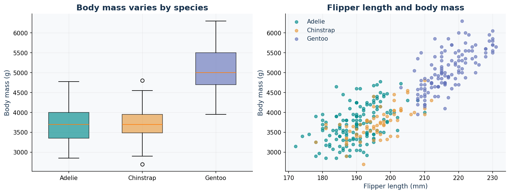

# Task 1 · Comprehensive Kaggle EDA

Explore the **Palmer Penguins** dataset through explicit questions, quality
checks, grouped statistics, figures, and cautious interpretation.

[Executed notebook](notebooks/penguins_eda.ipynb) · [Final report](reports/final_report.md)
· [Data dictionary](docs/data_dictionary.md) · [Source attribution](../docs/DATA_SOURCES.md)

## Questions

1. Which species and islands are represented in the sample?
2. Which fields are missing or need normalization?
3. How do body mass and flipper measurements differ by species?
4. How does pooled correlation compare with within-species correlation?
5. Can island differences be separated from species composition?
6. How do complete-case results compare with available-data summaries?

## Run

From the repository root, after installing `requirements.txt`:

```bash
python -m task1_eda.analysis
```

For a separate output directory:

```bash
python -m task1_eda.analysis --output my_eda_run
```

The pipeline reads the included original Kaggle `penguins_size.csv`. It validates
the schema, normalizes labels and the `.` missing-value marker, and adds source-row
tracking. No numeric imputation or automatic statistical-outlier deletion is used.

## Outputs

| File/location | Purpose |
| --- | --- |
| `data/processed/penguins_clean.csv` | Prepared observations, with missing values preserved |
| `reports/data_quality.json` | Row counts, missingness, duplicate review, raw SHA-256 |
| `reports/species_summary.csv` | Group counts, mass/flipper summaries, bootstrap intervals |
| `reports/correlations.csv` | Pooled and within-species paired correlations |
| `reports/outlier_review.csv` | Within-species 1.5-IQR review flags |
| `reports/descriptive_statistics.csv` | Numeric distributions and quartiles |
| `reports/species_island_counts.csv` | Evidence of sample confounding |
| `reports/figures/` | Four figure files |
| `reports/final_report.md` | Generated findings, limitations, and recommendations |



## Key interpretation

There are 344 records and 333 complete cases. Gentoo has greater mean mass in
this sample. The pooled flipper/mass correlation is 0.871, but species-specific
relationships differ. Gentoo occurs only on Biscoe and Chinstrap only on Dream,
so a location difference cannot be interpreted as an independent island effect.

Bootstrap intervals assume independent observations. This is not a census,
causal analysis, or claim about all penguins. The simplified data have no unique
animal ID, so identical measurements are not automatically deleted as duplicates.
