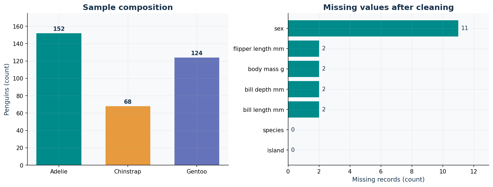
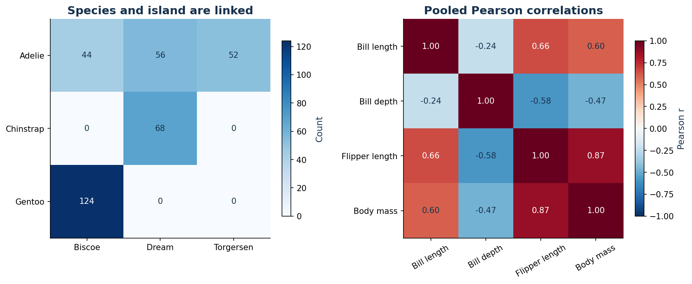
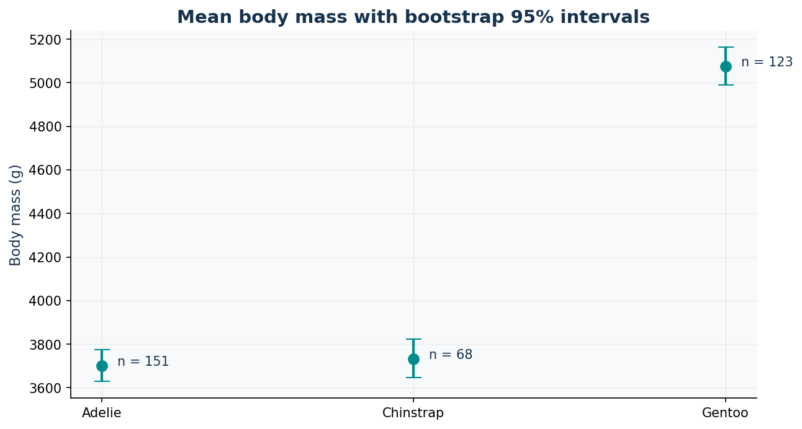

# Palmer Penguins: EDA findings

## Questions and scope

Which species are represented? Which measurements differ between species? How
does flipper length relate to mass within species? Can island differences be
interpreted separately from species? How sensitive are summaries to missingness?

Source: [Kaggle Palmer Archipelago dataset](https://www.kaggle.com/datasets/parulpandey/palmer-archipelago-antarctica-penguin-data),
`penguins_size.csv`. See [data dictionary](../docs/data_dictionary.md) for units
and [sources](../../docs/DATA_SOURCES.md) for provenance and attribution.

## Data quality

- 344 raw records; 344 retained. No values were invented or imputed.
- 1 nonstandard sex token(s) normalized to missing.
- 19 missing cells after normalization; 333 complete cases.
- 0 exact repeated measurement rows found.
- Each descriptive statistic uses its own available observations. Sex-only comparisons
  would exclude unknown sex; mass summaries retain records with known mass.
- Within-species IQR flags are exported for review. No statistical outliers were deleted.

## Findings supported by the data

| species | rows | measured_mass | mean_mass_g | median_mass_g | mean_flipper_mm | mass_ci_low_g | mass_ci_high_g |
| --- | --- | --- | --- | --- | --- | --- | --- |
| Adelie | 152 | 151 | 3,700.7 | 3,700.0 | 190.0 | 3,628.1 | 3,773.4 |
| Chinstrap | 68 | 68 | 3,733.1 | 3,700.0 | 195.8 | 3,645.6 | 3,822.4 |
| Gentoo | 124 | 123 | 5,076.0 | 5,000.0 | 217.2 | 4,990.4 | 5,163.6 |

1. Gentoo mean body mass is 5,076 g versus 3,701 g for Adelie,
   a sample difference of 1,375 g. The bootstrap intervals describe
   resampling uncertainty under an independent-observation assumption, not population coverage.
2. Pooled flipper-length/body-mass correlation is 0.871.
   Within-species correlations below show why pooled relationships should not be
   interpreted as a single species-independent biological effect.
3. Gentoo observations occur only on Biscoe and Chinstrap only on Dream. Species
   and island are confounded in this sample; an island difference is not an island effect.
4. Species counts are unequal. These counts describe the supplied sample, not
   the proportion of penguins in Antarctica.

| group | paired_n | pearson_r |
| --- | --- | --- |
| All species | 342 | 0.871 |
| Adelie | 151 | 0.468 |
| Chinstrap | 68 | 0.642 |
| Gentoo | 123 | 0.703 |

## Missingness sensitivity

The complete-case mass mean is 4,207.1 g;
the available-mass mean is 4,201.8 g. This descriptive check
does not prove that missing values are random.

## Recommendations and limitations

- Report measurements by species and show sample sizes with uncertainty intervals.
- Review flagged measurements against original field records before changing them.
- Collect a more balanced species/island sample before estimating island effects.
- The simplified dataset has no unique individual identifier or sampling-design
  metadata. Identical measurements alone are not a safe deduplication key, and
  clustered/repeated observations could make bootstrap intervals too narrow.
- This is observational EDA, not a causal study, population census, or predictive model.
- Raw data are included and checksummed so another reviewer can reproduce every table.

## Figures

