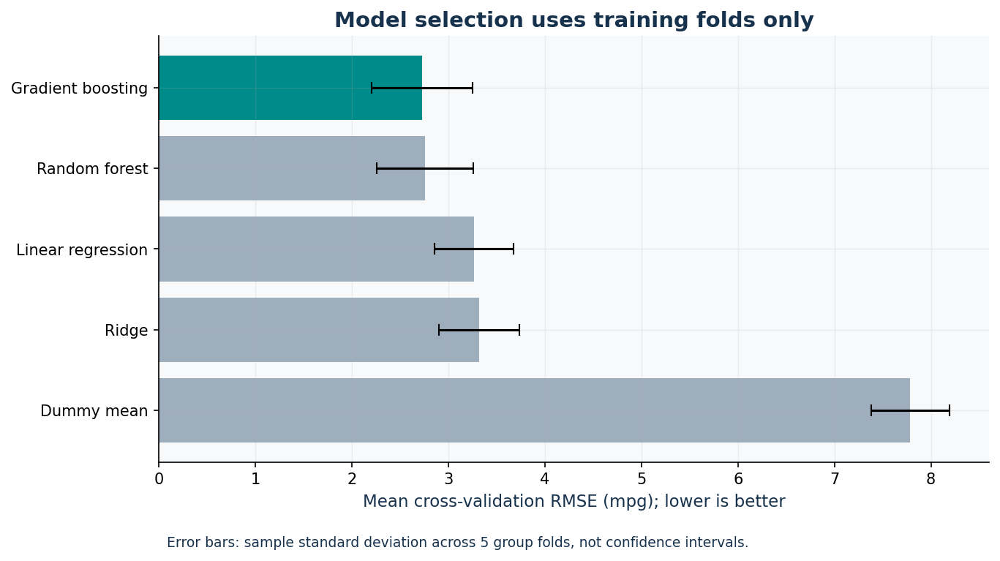

# Task 2 · End-to-end predictive regression

Predict **Auto MPG** fuel efficiency from seven vehicle attributes with
training-only preprocessing, group-aware evaluation, and a reproducible prediction CLI.

[Executed notebook](notebooks/auto_mpg_regression.ipynb) · [Final report](reports/final_report.md)
· [Measured metrics](reports/metrics.json) · [Data dictionary](docs/data_dictionary.md)

## X and y

```python
X = data[["cylinders", "displacement", "horsepower", "weight",
          "acceleration", "model_year", "origin"]]
y = data["mpg"]
```

`car_name` is a split-group label, not a predictor. `source_row` is an audit ID.
The target is continuous, so MAE/MSE/RMSE/R² apply; classification metrics do not.

## Evaluation design

1. Validate original UCI records and normalize names/origin codes.
2. Hold out 20% of exact normalized car-name groups using seed 42.
3. Use five-fold GroupKFold on the training records only.
4. Fit median imputation, scaling, and one-hot encoding **inside** each fold's pipeline.
5. Compare fixed Dummy, Linear, Ridge, Random Forest, and Gradient Boosting candidates.
6. Freeze the lowest-mean-CV-RMSE model, then score it and the baseline on the holdout.
7. Save predictions, residuals, permutation importance, split evidence, metadata,
   and the local model; verify that reloading preserves predictions.

Group names do not overlap, but related models with different names may still be
dependent. Selection is not made using the test scores.

## Run and predict

From the repository root:

```bash
python -m task2_regression.train
python -m task2_regression.predict --input task2_regression/examples/new_cars.csv --output my_predictions.csv
```

Choose a new output filename if one already exists. The sample specifications are
illustrative and include a missing horsepower value. Feature columns are required;
blank cells are imputed by the fitted pipeline. Origins use `usa`, `europe`, `japan`.
`model_year` uses historical 70–82 coding, not a four-digit year.

The `.joblib` model is generated locally and intentionally not versioned. Keep the
pinned environment, and never load untrusted model files. No API credentials are needed.

## Measured outcome

| Item | Result |
| --- | --- |
| Dataset | 398 rows, including 6 missing horsepower values |
| Training / holdout | 321 / 77 rows, zero exact-name overlap |
| Selected model | Gradient Boosting |
| Mean 5-fold CV RMSE | 2.730 mpg |
| Holdout MAE | 1.940 mpg |
| Holdout RMSE | 2.689 mpg |
| Holdout R² | 0.885 |

The baseline holdout RMSE is 7.955 mpg. Full MSE and baseline metrics are in
`reports/metrics.json`. R² is not an accuracy percentage.



## Limitations

This historical 1970–1982 benchmark is not validated for modern cars or EVs.
The grouped random test is not a future-year forecast. The holdout is small,
prediction intervals are not provided, and correlated predictors complicate
importance interpretation. Out-of-range data or unseen origins require review.
