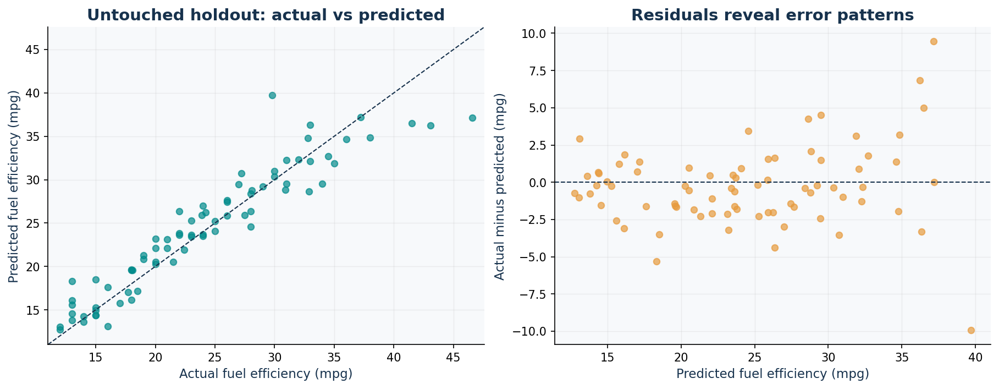
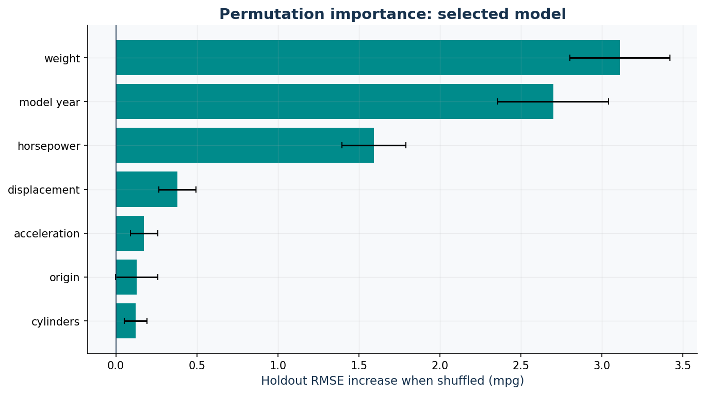

# Auto MPG: regression results

## Problem

Estimate historical city-cycle fuel efficiency (mpg) from seven vehicle
attributes. `mpg` is a continuous target, so this is regression, not classification.
Source: [UCI Auto MPG](https://archive.ics.uci.edu/dataset/9/auto+mpg).
See [data dictionary](../docs/data_dictionary.md) for feature units and coding.

## Evaluation protocol

- 398 source records; 6 missing horsepower values are retained.
- Split by exact normalized car name with seed 42: 321 training rows
  across 244 names; 77 test rows across 61 names.
- Test size is 20% of names, not necessarily 20% of rows. Name overlap is zero.
- Five-fold GroupKFold runs exclusively on training records with zero name overlap
  in every fold. Related models with different names may still be correlated.
- Median imputation, scaling, and categorical encoding fit inside each training fold.
- Fixed model configurations are compared by mean CV RMSE. No test-based selection.
- `car_name`, `source_row`, and the target are excluded from predictors.

## Cross-validation model comparison

| model | cv_rmse_mean_mpg | cv_rmse_std_mpg | cv_mae_mean_mpg | cv_r2_mean |
| --- | --- | --- | --- | --- |
| Gradient boosting | 2.730 | 0.521 | 2.019 | 0.872 |
| Random forest | 2.761 | 0.502 | 1.998 | 0.870 |
| Linear regression | 3.264 | 0.408 | 2.537 | 0.820 |
| Ridge | 3.320 | 0.415 | 2.544 | 0.815 |
| Dummy mean | 7.787 | 0.409 | 6.563 | -0.018 |

The selected model is **Gradient boosting**. Fold standard deviations describe fold
variation; they are not confidence intervals. These CV scores are used for selection
and may be optimistic after comparing multiple candidates.

## Final holdout evaluation

| model | mae_mpg | mse_mpg_squared | rmse_mpg | r2 |
| --- | --- | --- | --- | --- |
| Gradient boosting | 1.940 | 7.233 | 2.689 | 0.885 |
| Dummy mean | 6.473 | 63.288 | 7.955 | -0.007 |

The selected model reduces holdout RMSE by 66.2% relative to a constant
training-mean prediction. R² is not a classification accuracy percentage.
MAE and RMSE use mpg; MSE uses squared mpg. These are measured outputs of this run,
not illustrative scores or a guarantee of future performance.

## Diagnostic subgroup errors

| origin | test_rows | mae_mpg |
| --- | --- | --- |
| europe | 18 | 2.624 |
| japan | 15 | 2.200 |
| usa | 44 | 1.571 |

Subgroups can be small. These values are descriptive and were not used to retune
the model. Residuals and permutation importance are also post-selection diagnostics.
Correlated predictors can share importance; importance is not causal influence.

## Limitations and next steps

- Historical 1970–1982 vehicles only. Do not use this model for modern vehicles,
  EVs, safety decisions, regulatory fuel-economy claims, or price prediction.
- A grouped random split evaluates held-out names from this historical data, not
  forecasting a future year. A time-ordered evaluation is a separate next step.
- Exact-name grouping cannot resolve typos, shared manufacturers, or model families.
- One small holdout has uncertainty. Evaluate additional external data before deployment.
- No prediction intervals are provided. Out-of-range inputs and unseen origins need review.
- The saved pipeline is fitted on training records only, and reload predictions were
  checked against the original fit. Load joblib files only from trusted sources.

## Figures

